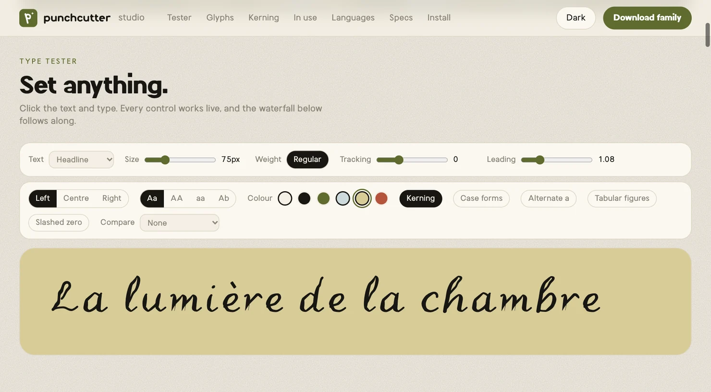
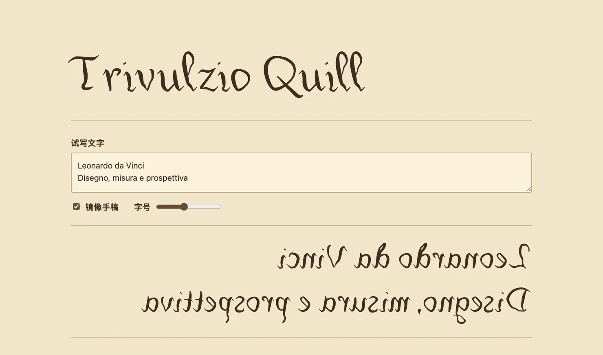

<h1 align="center">Qiaomu Fonts · 乔木手稿字体</h1>

<p align="center">
  从历史手稿重绘的开源拉丁字体，用于标题、封面和书信排版。<br>
  Open Latin display fonts drawn from historical handwriting.
</p>

<p align="center">
  <a href="https://github.com/joeseesun/qiaomu-fonts/releases/download/v1.0.0/qiaomu-fonts-v1.0.0.zip"><strong>下载全部四套</strong></a> ·
  <a href="https://github.com/joeseesun/qiaomu-fonts/releases/tag/v1.0.0">单套下载</a> ·
  <a href="docs/sources.md">手稿出处</a> ·
  <a href="OFL.txt">SIL OFL 1.1</a> ·
  <a href="#english">English</a>
</p>


## 字体图鉴

从达芬奇手稿的细起笔，到梵高信里的粗圆笔画。每套字体都记录了参考页，打开[手稿出处](docs/sources.md)可以对照原件。

| 字体 | 取自哪份手稿 | 笔迹特征 | 下载 |
| --- | --- | --- | --- |
| **Trivulzio Quill** | 达芬奇《特里武尔齐奥手稿》 | 窄字身、长回钩，附镜像试写 | [ZIP](https://github.com/joeseesun/qiaomu-fonts/releases/download/v1.0.0/trivulzio-quill.zip) · [样张](specimens/trivulzio-quill.png) |
| **Chawton Script** | 简·奥斯汀《苏珊夫人》誊清稿 | 低字身、右倾、细长连笔 | [ZIP](https://github.com/joeseesun/qiaomu-fonts/releases/download/v1.0.0/chawton-script.zip) · [样张](specimens/chawton-script.png) |
| **Arles Letter** | 梵高在阿尔勒写给提奥的信 | 字身较直，笔画圆厚 | [ZIP](https://github.com/joeseesun/qiaomu-fonts/releases/download/v1.0.0/arles-letter.zip) · [样张](specimens/arles-letter.png) |
| **Monticello Draft** | 杰斐逊《独立宣言》草稿 | 窄斜的字形，紧凑的笔环 | [ZIP](https://github.com/joeseesun/qiaomu-fonts/releases/download/v1.0.0/monticello-draft.zip) · [样张](specimens/monticello-draft.png) |

## 安装与试写

- **桌面排版**　解压后任选 TTF 或 OTF 安装。四套均为 Regular 400，覆盖基本拉丁字母、数字、标点及常用重音字符。
- **网页排版**　将包内的 CSS 和 `webfonts/` 放在一起，引用 CSS 即可加载 WOFF2。
- **修改字形**　下载包内有可编辑 UFO、绘图源文件和字形样张。字体采用 [SIL OFL 1.1](OFL.txt)，支持商用、嵌入和修改，具体条款见许可证。

### Font Studio

在任一字体包中打开 `fonts/studio.html`，直接输入自己的文字，调整字号、字距和行距，也可以查看单字轮廓。下图是用梵高字体排的一行法文。



### 达芬奇镜像试写

在 Trivulzio Quill 下载包中打开 `mirror.html`。像平常一样打字，勾选「镜像手稿」后，整行会按手稿的方式翻转。两种预览都可在本地浏览器离线使用。



## 还可以做哪些手稿？

[下一批候选](docs/manuscript-candidates.md)收录了可查看原件的档案，包括狄金森的铅笔诗稿、牛顿的大学笔记、玛丽·雪莱的小说草稿和弗雷德里克·道格拉斯的亲笔信。也欢迎在 [Issues](https://github.com/joeseesun/qiaomu-fonts/issues) 提供手稿来源。

<details>
<summary>从源码构建 · Build from source</summary>

需要 Python 3.10+、Cairo，以及 [Punchcutter 1.3.1 的固定提交](https://github.com/byrishi/punchcutter/tree/4a265038d1399f3e96e5fc8cb5ee9b935800ce05)。在虚拟环境中安装 Punchcutter 的 `skills/punchcutter/scripts/requirements.txt`。macOS 可通过 Homebrew 安装 `cairo`，Debian 或 Ubuntu 可安装 `libcairo2`。

```bash
./scripts/build-fonts.sh /path/to/punchcutter/skills/punchcutter
python scripts/package-fonts.py
```

构建输出在 `build/<字体目录名>/`。在构建命令后附上字体目录名即可单独构建。打包脚本读取四套构建结果，验证字库并生成 `build/releases/` 下的 ZIP。首发四套字体通过 100 项构建检查，相关报告随包提供。

Python 3.10+, Cairo and the pinned Punchcutter revision above are required. Install Punchcutter's requirements in a virtual environment and run the two commands. See the build reports included in the release ZIPs.

</details>

## English

Qiaomu Fonts brings historical pen styles into contemporary Latin display type. [Download all four](https://github.com/joeseesun/qiaomu-fonts/releases/download/v1.0.0/qiaomu-fonts-v1.0.0.zip) or pick a family from the table. The first release covers Leonardo da Vinci, Jane Austen, Vincent van Gogh and Thomas Jefferson.

Install either the TTF or the OTF on your computer. For web use, keep the bundled CSS next to `webfonts/`. Open `fonts/studio.html` to try your text offline. Trivulzio Quill also includes `mirror.html` for right-to-left mirrored display. The release includes editable UFOs and source drawings. All four families are Regular 400 and cover Basic Latin and common accented letters. See the [manuscript references](docs/sources.md), [research shortlist](docs/manuscript-candidates.md) and [SIL Open Font License 1.1](OFL.txt).

由[向阳乔木](https://qiaomu.ai/)维护 · [博客](https://blog.qiaomu.ai/) · [乔木推荐](https://tuijian.qiaomu.ai/) · [X @vista8](https://x.com/vista8) · [GitHub @joeseesun](https://github.com/joeseesun/) · 微信公众号「向阳乔木推荐看」
