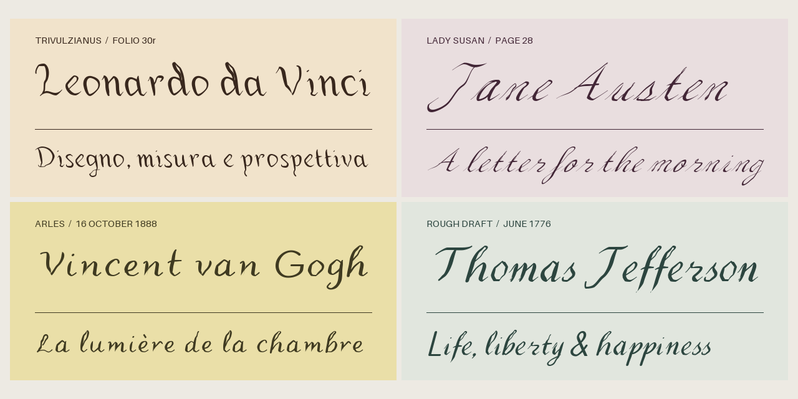

# Qiaomu Fonts

从历史人物的手稿重绘拉丁字体，用于标题、海报和书信排版。

Open Latin display fonts inspired by historical handwriting.

**中文** · [English](#english) · [下载全部](https://github.com/joeseesun/qiaomu-fonts/releases/download/v1.0.0/qiaomu-fonts-v1.0.0.zip) · [OFL 1.1](OFL.txt)



| 手稿作者 | 字体 | 笔迹特征 | 下载 |
| --- | --- | --- | --- |
| 列奥纳多·达芬奇 | **Trivulzio Quill** | 窄字身、细起笔、长回钩。附离线镜像试写页 | [ZIP](https://github.com/joeseesun/qiaomu-fonts/releases/download/v1.0.0/trivulzio-quill.zip) · [样张](specimens/trivulzio-quill.png) |
| 简·奥斯汀 | **Chawton Script** | 《苏珊夫人》誊清稿里的低字身、右倾与长连笔 | [ZIP](https://github.com/joeseesun/qiaomu-fonts/releases/download/v1.0.0/chawton-script.zip) · [样张](specimens/chawton-script.png) |
| 文森特·梵高 | **Arles Letter** | 阿尔勒书信里比较直立、圆厚的钢笔笔迹 | [ZIP](https://github.com/joeseesun/qiaomu-fonts/releases/download/v1.0.0/arles-letter.zip) · [样张](specimens/arles-letter.png) |
| 托马斯·杰斐逊 | **Monticello Draft** | 《独立宣言》草稿主文的窄斜体与紧凑笔环 | [ZIP](https://github.com/joeseesun/qiaomu-fonts/releases/download/v1.0.0/monticello-draft.zip) · [样张](specimens/monticello-draft.png) |

在 macOS 或 Windows 上，解压后任选 **TTF 或 OTF** 安装。网页使用同包的 **WOFF2 和 CSS**。各包均含可编辑的 UFO、字形绘图脚本和离线排版预览。达芬奇字体以正读方式安装，在同包的 `mirror.html` 里可输入文字并切换整行镜像。

四套字体均为 Regular 400，涵盖基本拉丁字母、数字、标点及常用拉丁扩展字符。每套字体都经过 TTF 和 OTF 构建检查，并验证了 WOFF2 的字符映射及授权信息。字形为现代重绘，具体参考页与重绘范围见[手稿出处](docs/sources.md)。

## 从源码构建

需要 Python 3.10+、Cairo，以及 [Punchcutter 1.3.1 的固定提交](https://github.com/byrishi/punchcutter/tree/4a265038d1399f3e96e5fc8cb5ee9b935800ce05)。先在虚拟环境中安装 Punchcutter 的 `skills/punchcutter/scripts/requirements.txt`。macOS 可用 Homebrew 安装 `cairo`，Debian 或 Ubuntu 可用 `libcairo2`。

```bash
./scripts/build-fonts.sh /path/to/punchcutter/skills/punchcutter
python scripts/package-fonts.py
```

用单个字体目录名作为构建命令的第二个参数可以单独重建。构建输出在 `build/<字体目录名>/`。打包脚本读取四套构建结果并检查字库，整理仓库中的字体、样张和 `build/releases/` ZIP。

欢迎在 [Issues](https://github.com/joeseesun/qiaomu-fonts/issues) 提供带档案出处的手稿建议或字形问题。本项目由[向阳乔木](https://qiaomu.ai/)维护 · [博客](https://blog.qiaomu.ai/) · [乔木推荐](https://tuijian.qiaomu.ai/) · [X @vista8](https://x.com/vista8) · [GitHub @joeseesun](https://github.com/joeseesun/) · 微信公众号「向阳乔木推荐看」。

## English

Qiaomu Fonts is a collection of newly drawn Latin display fonts based on manuscript references. The first release includes Leonardo’s **Trivulzio Quill**, Jane Austen’s **Chawton Script**, Van Gogh’s **Arles Letter**, and Jefferson’s **Monticello Draft**.

[Download all four](https://github.com/joeseesun/qiaomu-fonts/releases/download/v1.0.0/qiaomu-fonts-v1.0.0.zip) or choose a ZIP from the table. Install either the TTF or OTF for desktop use. Put the WOFF2 file and the supplied CSS on your website for web use. Trivulzio Quill’s offline mirror page flips the displayed line while you type normally.

All four fonts are Regular 400 and cover Basic Latin and common accented Latin characters. The source includes original pen drawings and editable UFOs in the release. See the [manuscript references](docs/sources.md), [build instructions](#从源码构建), and [SIL Open Font License 1.1](OFL.txt). Font checks cover character mapping, metrics, outlines, kerning and font metadata.
